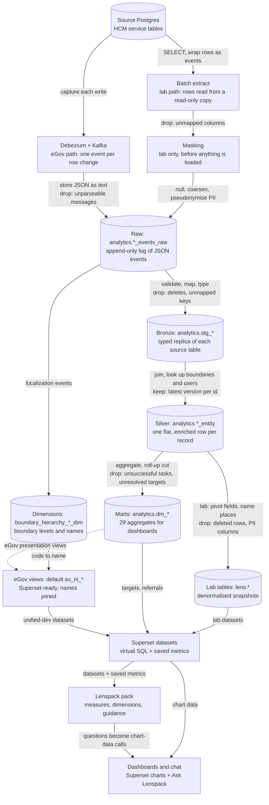

# Analytics pipeline: from HCM records to dashboards and chat

How HCM campaign data becomes the tables that Superset and Lenspack read: the schemas it starts from, the SQL that
runs at each step, what each step transforms and drops, the problems we hit, and what exists at the end.

There are two paths through the same pipeline:

- **eGov's path (unified-dev, eGov's development cluster).** HCM services write to Postgres. Debezium and Kafka carry
  every change to ClickHouse, and eGov's
  [Kafka-Postgres-Health-Analytics](https://github.com/prerna-egov/Kafka-Postgres-Health-Analytics) SQL and Airflow
  DAGs (scheduled jobs) build raw, bronze, silver and mart tables: from a copy of each event, to a typed copy of each
  table, to one flat row per record, to summaries for dashboards. On top of these, eGov's Superset-ready views
  (`default.su_ni_*`) serve the Superset datasets that [`demo-data/setup/setup.mts`](../demo-data/setup/setup.mts)
  creates. The data in unified-dev is synthetic.
- **Our lab path.** A masked extract of one state's 2025 seasonal malaria chemoprevention (SMC) campaign runs through
  the same eGov SQL and DAGs, unchanged, on a ClickHouse of our own. Flat tables for Lenspack (`lens.*`) are built
  from silver, and the lab's Superset datasets read those. The step-by-step commands are in our lab notes, which are
  not public, and no lab data is in this repository.

All eGov file links below point at commit
[`109cf4d`](https://github.com/prerna-egov/Kafka-Postgres-Health-Analytics/tree/109cf4dd1a8315eac8f23d7692f57d588195c6a3)
of branch `health_table_schema`, the version both paths ran.

## Contents

- [The flow](#the-flow)
- [The SQL, in run order](#the-sql-in-run-order)
- [1. Source Postgres](#1-source-postgres)
- [2. Change events: Debezium and Kafka, or a batch extract](#2-change-events-debezium-and-kafka-or-a-batch-extract)
- [3. Masking (lab only)](#3-masking-lab-only)
- [4. Raw event store](#4-raw-event-store)
- [5. Bronze](#5-bronze)
- [6. Silver](#6-silver)
- [7. Dimensions](#7-dimensions)
- [8. Marts](#8-marts)
- [9. eGov's Superset-ready views (unified-dev)](#9-egovs-superset-ready-views-unified-dev)
- [10. Our lab tables: `lens.*`](#10-our-lab-tables-lens)
- [11. Superset datasets](#11-superset-datasets)
- [12. The Lenspack pack](#12-the-lenspack-pack)
- [13. Dashboards and chat](#13-dashboards-and-chat)
- [The final result](#the-final-result)
- [Why `lens.*` exists, and where it's going](#why-lens-exists-and-where-its-going)

## The flow

Solid arrows are data moving from one stage to the next; each label says what happens on the way, and `drop:` names
what is left behind. The dotted arrow is eGov's own view layer, whose SQL is not in the public repo.



## The SQL, in run order

| Step | eGov file | What it creates or does | How it runs |
|---|---|---|---|
| Kafka consumers | [`01_kafka_event_consumers.sql`](https://github.com/prerna-egov/Kafka-Postgres-Health-Analytics/blob/109cf4dd1a8315eac8f23d7692f57d588195c6a3/ClickHouse_ddl/01_kafka_event_consumers.sql) | `kafka_<table>_events` Kafka-engine tables, one per topic | DDL, eGov path only |
| Raw store | [`02_raw_events_store.sql`](https://github.com/prerna-egov/Kafka-Postgres-Health-Analytics/blob/109cf4dd1a8315eac8f23d7692f57d588195c6a3/ClickHouse_ddl/02_raw_events_store.sql) | 39 `<table>_events_raw` tables | DDL |
| Raw ingestion | [`03_raw_events_ingestion_mvs.sql`](https://github.com/prerna-egov/Kafka-Postgres-Health-Analytics/blob/109cf4dd1a8315eac8f23d7692f57d588195c6a3/ClickHouse_ddl/03_raw_events_ingestion_mvs.sql) | `mv_<table>_events_raw`, Kafka table → raw table | DDL, eGov path only; the lab loads raw from files |
| Bronze | [`04_bronze_tables.sql`](https://github.com/prerna-egov/Kafka-Postgres-Health-Analytics/blob/109cf4dd1a8315eac8f23d7692f57d588195c6a3/ClickHouse_ddl/04_bronze_tables.sql) | 39 `stg_<table>` tables | DDL |
| Bronze projections | [`14_bronze_projections.sql`](https://github.com/prerna-egov/Kafka-Postgres-Health-Analytics/blob/109cf4dd1a8315eac8f23d7692f57d588195c6a3/ClickHouse_ddl/14_bronze_projections.sql) | Narrow projections on the `stg_*` tables for window reads and joins | DDL, after 04 and before the silver DAG |
| Raw → bronze | [`raw_event_to_bronze_orchestrator.py`](https://github.com/prerna-egov/Kafka-Postgres-Health-Analytics/blob/109cf4dd1a8315eac8f23d7692f57d588195c6a3/airflow_dags/dags/raw_event_to_bronze_orchestrator.py), [`raw_event_bronze_config.py`](https://github.com/prerna-egov/Kafka-Postgres-Health-Analytics/blob/109cf4dd1a8315eac8f23d7692f57d588195c6a3/airflow_dags/dags/raw_event_bronze_config.py), [`raw_event_bronze_processor.py`](https://github.com/prerna-egov/Kafka-Postgres-Health-Analytics/blob/109cf4dd1a8315eac8f23d7692f57d588195c6a3/airflow_dags/dags/raw_event_bronze_processor.py) | Fills bronze from raw | Airflow DAG `raw_event_to_bronze`, one mapped `process_table` task per table |
| Silver | [`05_silver_tables.sql`](https://github.com/prerna-egov/Kafka-Postgres-Health-Analytics/blob/109cf4dd1a8315eac8f23d7692f57d588195c6a3/ClickHouse_ddl/05_silver_tables.sql) | `<entity>_entity` and `<entity>_campaign_field` tables | DDL, with `--database analytics` (05 to 15 use unqualified names) |
| Bronze → silver | [`bronze_to_silver_task_orchestrator.py`](https://github.com/prerna-egov/Kafka-Postgres-Health-Analytics/blob/109cf4dd1a8315eac8f23d7692f57d588195c6a3/airflow_dags/dags/sql_based_dags/bronze_to_silver_task_orchestrator.py), [`sql_flatten_common.py`](https://github.com/prerna-egov/Kafka-Postgres-Health-Analytics/blob/109cf4dd1a8315eac8f23d7692f57d588195c6a3/airflow_dags/dags/sql_based_dags/sql_flatten_common.py), 22 [`<entity>_transformation.py`](https://github.com/prerna-egov/Kafka-Postgres-Health-Analytics/tree/109cf4dd1a8315eac8f23d7692f57d588195c6a3/airflow_dags/dags/sql_based_dags) | Fills silver from bronze | Airflow DAG `bronze_to_silver_task_orchestrator`, one `run_transformation(SPEC, window)` task per entity |
| Dimensions | [`06_dimension_tables.sql`](https://github.com/prerna-egov/Kafka-Postgres-Health-Analytics/blob/109cf4dd1a8315eac8f23d7692f57d588195c6a3/ClickHouse_ddl/06_dimension_tables.sql) | `boundary_hierarchy_dim`, `boundary_hierarchy_localization_dim` | DDL |
| Mart storage | [`07_mart_tables.sql`](https://github.com/prerna-egov/Kafka-Postgres-Health-Analytics/blob/109cf4dd1a8315eac8f23d7692f57d588195c6a3/ClickHouse_ddl/07_mart_tables.sql) | 29 `dm_*` target tables | DDL, before 08 |
| Mart logic | [`08_coverage_marts.sql`](https://github.com/prerna-egov/Kafka-Postgres-Health-Analytics/blob/109cf4dd1a8315eac8f23d7692f57d588195c6a3/ClickHouse_ddl/08_coverage_marts.sql), [`09_complaints_marts.sql`](https://github.com/prerna-egov/Kafka-Postgres-Health-Analytics/blob/109cf4dd1a8315eac8f23d7692f57d588195c6a3/ClickHouse_ddl/09_complaints_marts.sql), [`10_overview_marts.sql`](https://github.com/prerna-egov/Kafka-Postgres-Health-Analytics/blob/109cf4dd1a8315eac8f23d7692f57d588195c6a3/ClickHouse_ddl/10_overview_marts.sql), [`11_inventory_marts.sql`](https://github.com/prerna-egov/Kafka-Postgres-Health-Analytics/blob/109cf4dd1a8315eac8f23d7692f57d588195c6a3/ClickHouse_ddl/11_inventory_marts.sql), [`12_dashboard_marts.sql`](https://github.com/prerna-egov/Kafka-Postgres-Health-Analytics/blob/109cf4dd1a8315eac8f23d7692f57d588195c6a3/ClickHouse_ddl/12_dashboard_marts.sql), [`14_sync_marts.sql`](https://github.com/prerna-egov/Kafka-Postgres-Health-Analytics/blob/109cf4dd1a8315eac8f23d7692f57d588195c6a3/ClickHouse_ddl/14_sync_marts.sql), [`15_referral_marts.sql`](https://github.com/prerna-egov/Kafka-Postgres-Health-Analytics/blob/109cf4dd1a8315eac8f23d7692f57d588195c6a3/ClickHouse_ddl/15_referral_marts.sql) | 29 refreshable materialized views `mv_dm_*`, each writing one `dm_*` table | DDL, then `SYSTEM REFRESH VIEW` + `SYSTEM WAIT VIEW` per view, dependencies first |
| KPI queries | [`13_kpi_queries.sql`](https://github.com/prerna-egov/Kafka-Postgres-Health-Analytics/blob/109cf4dd1a8315eac8f23d7692f57d588195c6a3/ClickHouse_ddl/13_kpi_queries.sql) | Read-only example queries over the marts | Not DDL; nothing to run |
| Downstream Postgres | [`ddl/01_transformed_data_tables.sql`](https://github.com/prerna-egov/Kafka-Postgres-Health-Analytics/blob/109cf4dd1a8315eac8f23d7692f57d588195c6a3/ddl/01_transformed_data_tables.sql) | Enriched tables in a separate reporting Postgres | Not used by either path here |
| Superset-ready views | not public | `default.su_ni_*` on unified-dev | eGov |
| Lab tables | our lab notes (not public) | `lens.*` from silver | One SQL script, after the marts |
| Superset datasets | [`demo-data/setup/setup.mts`](../demo-data/setup/setup.mts) (unified-dev); the lab's are made the same way through Superset's API | Virtual datasets with saved metrics | One-off, safe to re-run |

The mart refresh order (dependencies first) that both the lab and the repo's comments imply:

1. coverage base: `dm_successful_deliveries_base`, `dm_targets_base`, `dm_campaign_hierarchy`, `dm_coverage_by_node`;
2. `dm_smc_administered_base`, `dm_smc_administered_by_beneficiary`, then `dm_campaign_coverage`;
3. complaints: `dm_complaints_base`, `dm_complaints_open_ageing`, `dm_complaints_resolution`;
4. overview: `dm_smc_administered_by_campaign`, `dm_campaign_daily_progress`, `dm_campaign_gender_breakdown`,
   `dm_zero_dose_daily_by_node`, `dm_missed_children_daily_by_node`, `dm_smc_adverse_events`, `dm_stock_balance`;
5. inventory: `dm_stock_transactions`, `dm_stock_facility_points`, `dm_stock_reconciliation`;
6. dashboard: `dm_attendance`, `dm_household_registry`, `dm_referral_summary`, `dm_suspected_fraud`;
7. sync: `dm_user_sync`, `dm_cdd_sync_hourly`;
8. referral: `dm_referral_by_facility`, `dm_referral_by_symptom`, `dm_hf_checklist_outcome`.

## 1. Source Postgres

**What it is.** The operational database behind the DIGIT HCM services. The mobile app syncs records to the services,
which write them here.

**Input schema** (the tables the pipeline reads, grouped):

| Group | Tables |
|---|---|
| Registration | `household`, `household_member`, `individual`, `individual_address`, `address`, `project_beneficiary` |
| Delivery | `project_task`, `task_resource` (one row per product given in a task) |
| Campaign set-up | `project` (one row per campaign node: a boundary in the campaign's tree), `project_target`, `project_address`, `project_staff`, `project_facility`, `product`, `product_variant`, `facility` |
| Stock | `stock`, `stock_reconciliation_log` |
| Referrals and side effects | `referral`, `hf_referral`, `side_effect` |
| Checklists | `eg_service`, `eg_service_attribute_value`, `eg_service_definition` |
| Complaints | `eg_pgr_service_v2`, `eg_pgr_address_v2` |
| Attendance and payments | `eg_wms_attendance_register`, `_staff`, `_attendee`, `_log`, muster roll, `eg_expense_bill`, bill detail, line item, party |
| App telemetry | user actions, device tokens, user location |

Most rows carry the same column families:
- **keys:** a server `id`, and a `clientreferenceid` the phone made at creation (the offline key other records point
  to before sync);
- **audit:** `createdby`, `lastmodifiedby`, `createdtime`, `lastmodifiedtime` (epoch milliseconds), the client-side
  equivalents, `rowversion` and `isdeleted`;
- **campaign-specific data:** an `additionaldetails` JSON column, holding `fields: [{key, value}]` lists such as
  `cycleIndex`, `doseIndex` or `deliveryStrategy`.

The look-ups that silver needs later (the boundary tree, users and roles, MDMS master data, workflow state) are served
by other DIGIT services, not read from these tables.

**Issues at this stage.**
- **One schema per state.** eGov's topics are named `unified-dev.health.<table>`, which assumes a single source schema
  `health`. Nigeria's database has one schema per state, so topic names would have to change per state.
- **Schema drift.** Nigeria's `eg_pgr_service_v2` has no `hierarchytype` column, which the bronze mapping expects (see
  [bronze](#5-bronze)).

## 2. Change events: Debezium and Kafka, or a batch extract

**eGov's path.** Debezium reads Postgres's write-ahead log and publishes one JSON event per row change to a Kafka topic
per table. In ClickHouse, a `Kafka` engine table per topic (01) reads each message as one string
(`kafka_format = 'JSONAsString'`), and a materialized view per table (03) copies it into the raw store. Nothing is
parsed here.

- **Dropped:** messages ClickHouse cannot read, up to `kafka_skip_broken_messages = 100` per block.
- **Watch out:** never `SELECT` from a `kafka_*` table by hand. Reading one advances the consumer group's offset, and
  those messages never reach the raw store.

**Our lab path.** Debezium needs a replication slot, which a read-only database copy can't provide. Instead, rows were
read with `SELECT` and written as files of Debezium-shaped events, one JSON object per line with `op` and `after` (the
row), so the raw tables receive exactly what Debezium would have sent for a create.

- **Dropped:** history. A snapshot holds each row's current state only, not the intermediate versions a live feed
  would carry.
- **Also extracted:** the look-up tables the silver stage needs (boundaries, users and roles, MDMS data, workflow), as
  separate files.

## 3. Masking (lab only)

The lab data is real campaign data, so it is masked before it leaves the source machine. eGov's pipeline itself does
no masking: bronze `stg_individual` carries names, phone numbers and dates of birth, bronze addresses carry address
lines and full-precision coordinates, and silver keeps dates of birth, user names and coordinates. A warehouse that
Superset or Lenspack reads directly needs column-level grants or masked views.

**Method**, per row of every extracted table:

| Rule | Applied to |
|---|---|
| **Keep only mapped columns.** Columns that eGov's raw → bronze config doesn't read are dropped, so they never reach ClickHouse | every table (look-up tables have their own keep-lists) |
| **Null** | person names, phone numbers, email, photos, beneficiary user names, address lines, door numbers, landmarks, postcodes, complaint descriptions, free-text comments, payee and bank details, national ids, workflow comments |
| **Coarsen** | dates of birth to the first of their month; coordinates to a 0.1-degree grid |
| **Pseudonymise** with a keyed hash, so the same input always gives the same token and joins and distinct counts still work | staff names and user names, individual ids, waybill numbers, referral codes |
| **Allowlist JSON keys.** Inside `additionaldetails` and similar columns, only keys listed per table survive; others are dropped and counted | all JSON columns (campaign configuration in `project` is kept whole) |
| **Redact long free text** | checklist answers longer than a short code |
| **Sweep for phone numbers.** Anything phone-shaped left in a kept string is replaced by a token | every kept string |

Internal UUIDs are kept: they are random and needed for joins. The result is **pseudonymous, not anonymous**, and stays
behind the lab's login.

**Issues.** A leak audit of the masked output (counts only) found no real phone numbers, exact dates of birth or
individual coordinates, and a small residue in two places the rules let through: free-text descriptions in campaign
configuration, which is kept whole, and short free-text checklist answers under the length rule. Both rules are to be
tightened before any new extract.

**Output:** masked event files of the same shape, plus a manifest naming each file's raw table.

## 4. Raw event store

**Input:** the JSON events, one per line or message.

**Schema** ([02](https://github.com/prerna-egov/Kafka-Postgres-Health-Analytics/blob/109cf4dd1a8315eac8f23d7692f57d588195c6a3/ClickHouse_ddl/02_raw_events_store.sql)), identical for all 39 tables:

```sql
CREATE TABLE IF NOT EXISTS analytics.household_events_raw
(
    event_time DateTime64(3) DEFAULT now64(3),
    id         UUID          DEFAULT generateUUIDv4(),
    raw        String
)
ENGINE = MergeTree
PARTITION BY toYYYYMM(event_time)
ORDER BY (event_time, id);
```

Append-only (`MergeTree`, no updates or deletes), so it is a replayable log of every event.

**In the lab** each file was loaded with
`INSERT INTO analytics.<table>_events_raw (raw) FROM INFILE '…' COMPRESSION 'gzip' FORMAT LineAsString`, one event per
row, and the files were deleted afterwards.

- **Transformations:** none.
- **Dropped:** nothing.

**Issues.**
- **`event_time` is arrival time,** not the time the record changed. In the lab every event arrived at load time, so
  the bronze window ([below](#5-bronze)) is a window over load time and has to cover the whole load.
- **A missing raw table.** The bronze config maps `analytics.localization_events_raw` to
  `boundary_hierarchy_localization_dim`, but 02 doesn't create that raw table. Boundary names therefore have no path
  into ClickHouse through the pipeline (see [dimensions](#7-dimensions)).

## 5. Bronze

**What it is.** A typed replica of each source table, one row per source row, with snake_case names.

**Code:** the `raw_event_to_bronze` DAG. Per table, `process_table` reads the raw table in keyset-paginated pages
ordered by `(event_time, id)` inside a time window, takes each event's `after` object, maps its keys to bronze columns
using `raw_event_bronze_config.py`, coerces types, and inserts page by page.

**Schema** ([04](https://github.com/prerna-egov/Kafka-Postgres-Health-Analytics/blob/109cf4dd1a8315eac8f23d7692f57d588195c6a3/ClickHouse_ddl/04_bronze_tables.sql)): the source columns, plus `_ingested_at` (arrival time) and `event_id` (the raw row it came
from). Example, abridged:

```sql
CREATE TABLE IF NOT EXISTS analytics.stg_household
(
    _ingested_at DateTime64(3) DEFAULT now64(3),
    event_id String,
    id String, tenant_id LowCardinality(String), client_reference_id String,
    member_count Int32, household_type LowCardinality(String), address_id String,
    additional_details String,
    created_by String, last_modified_by String, created_time Int64, last_modified_time Int64,
    client_created_time Int64, client_last_modified_time Int64, row_version Int64, is_deleted Bool
)
ENGINE = ReplacingMergeTree(last_modified_time)
ORDER BY (tenant_id, id);
```

[14_bronze_projections](https://github.com/prerna-egov/Kafka-Postgres-Health-Analytics/blob/109cf4dd1a8315eac8f23d7692f57d588195c6a3/ClickHouse_ddl/14_bronze_projections.sql) adds narrow projections, by `_ingested_at` for window reads and by foreign keys
for joins, so silver doesn't scan whole tables. They don't change the data.

**Transformations.**
- Source keys are the lowercased Postgres names Debezium emits (`clientreferenceid`), mapped to bronze names
  (`client_reference_id`).
- JSON values are stored as JSON text; epoch milliseconds stay `Int64` (conversion to dates happens in silver).
- **Validation is loud:** before reading any data, every mapped bronze column must exist; on the first page, every
  configured source key must be present in the events, or the task fails.

**What is dropped, and why.**
- **Delete events** (`op = 'd'`) are excluded when raw is read: they carry no `after`. So bronze does not record hard
  deletes, and a hard-deleted row stays. Soft deletes arrive as updates with `is_deleted = true` and are kept.
- **Events with a null `after`** are dropped and fail the task (unless the table allows it), since a create or update
  should always carry one.
- **Source keys not in the mapping** are not copied; they are logged as a warning, which is how upstream schema drift
  shows.
- **Older versions of a row.** `ReplacingMergeTree(last_modified_time)` keeps one row per `(tenant_id, id)`, the latest,
  when parts merge. Readers use `FINAL` to get that result before merges finish.
- **Nulls lose their meaning.** Columns are non-Nullable, so a missing value becomes `''`, `0`, `false` or
  `1970-01-01`, indistinguishable from a real one.

**Issues and how they were handled.**
- **Missing source column (PGR).** The config maps `hierarchytype` for `eg_pgr_service_v2`, which Nigeria's schema
  lacks, so the source-key check failed. In the lab, the raw PGR events were given a null `hierarchytype` so the check
  passes.
- **Finding mismatches early.** Running the DAG to find a mismatch takes minutes per table. The lab ran eGov's own
  validators (`get_bronze_schema`, `validate_table_mapping`, `transform_page`) on a sample of each raw table first,
  which takes seconds.
- **Speed.** `airflow dags test` runs tables one after another. The lab called the same `process_table` five tables at
  a time instead; the code path is the DAG's.

**Output:** 39 `stg_*` tables.

## 6. Silver

**What it is.** One flat, analysis-ready row per record, with the boundary path, the user and the campaign context
joined in. Roughly the shape of HCM's Elasticsearch index documents, in snake_case.

**Code:** the `bronze_to_silver_task_orchestrator` DAG runs one task per entity (22 entities). Each calls
`sql_flatten_common.run_transformation(SPEC, window)`:

1. select the bronze rows whose `_ingested_at` falls in the window, through the `_ingested_at` projection, and split
   them into slices of at most 5,000 rows per tenant;
2. per slice, resolve the look-ups by calling DIGIT services from Python:
   - **boundary service:** a record's boundary code becomes its full path, `level_one_code` … `level_nine_code`, plus
     `hierarchy_type`;
   - **user service:** `user_name`, `name_of_user`, `role`, `user_address`;
   - **MDMS:** which role to show for a user with several;
   - **workflow service:** bill workflow status;
3. write the slice with one `INSERT … SELECT` inside ClickHouse that joins the bronze tables and embeds the look-up
   results as inline `VALUES` tables.

**Schema** ([05](https://github.com/prerna-egov/Kafka-Postgres-Health-Analytics/blob/109cf4dd1a8315eac8f23d7692f57d588195c6a3/ClickHouse_ddl/05_silver_tables.sql)), grouped:

| Group | Tables |
|---|---|
| Delivery | `project_task_entity` (one row per task resource), `project_task_campaign_field` |
| Registration | `household_entity`, `household_member_entity`, `project_beneficiary_entity`, each with a `_campaign_field` table |
| Campaign set-up | `project_entity` (one row per campaign node and target type, with targets), `project_staff_entity` |
| Stock | `stock_entity` (+ `stock_campaign_field`), `stock_reconciliation_entity` |
| Referrals and side effects | `referral_entity`, `hf_referral_entity`, `side_effect_entity` |
| Checklists | `service_task_entity`, `service_task_attribute_entity` |
| Complaints | `pgr_complaints_entity` |
| Attendance and payments | `attendance_log_entity`, `attendance_register_entity`, `attendee_entity`, `attendance_staff_entity`, `muster_roll_entity`, `bill_entity`, `bill_detail_entity` |
| App telemetry | `user_action_entity`, `device_token_entity` |

Every geography-aware table repeats the same column blocks:
- `level_one_code` … `level_nine_code`, `hierarchy_type`: the boundary path, as **codes**;
- `project_id`, `project_type`, `project_name`, `campaign_number`, `campaign_id`: the campaign context.
  `campaign_number` is the project's `referenceid`.

The `<entity>_campaign_field` tables hold everything campaign-specific as one row per `(id, key)`, with the value
typed into exactly one of `value_string`, `value_number`, `value_date`, `value_bool` or `value_array`: every
`additionalFields` key, plus derived keys such as `cycleIndex` and `doseIndex`, and for individual-based projects the
beneficiary's `age` (months), `gender` and `dateOfBirth`.

**Transformations** (project task as the example): the task joins its resources, address, project, product variant,
and its beneficiary, then the household or the individual depending on the project's beneficiary type. Epoch times
become `DateTime64`/`Date32` columns (`synced_time_stamp`, `task_dates`). `ReplacingMergeTree(last_modified_time)`
again keeps the latest version per id, so re-running a window is safe.

**What is dropped, and why.**
- **Rows outside the window.** Each run reads only its `_ingested_at` window; other rows are left for other runs.
- **Deleted task resources:** a resource whose latest version is deleted gives no silver row.
- **Duplicate bridge rows.** Joins through client reference ids keep one row per key, the newest version.
- **Beneficiary details when the individual isn't found:** `age`, `gender` and `dateOfBirth` are left out rather than
  guessed.
- **Not dropped:** a failed look-up leaves blank columns (for example blank boundary levels when the boundary service
  doesn't know a code) rather than dropping the row, and soft-deleted rows stay, with `is_deleted = true`, for the
  next layer to filter.

**Issues and how they were handled.**
- **No DIGIT services for the lab tenant.** Silver calls four services over HTTP. The lab ran a small read-only
  stand-in for them, serving the extracted look-ups: the boundary tree, users with pseudonymised names and their roles,
  and MDMS data. Its workflow endpoint returns nothing, so bill workflow status is blank in the lab. eGov's DAG code ran
  unchanged against it.
- **Big entities.** The largest entities were split into several `_ingested_at` sub-windows, which is safe because
  overlapping writes collapse in `ReplacingMergeTree`. Entities ran four at a time, each through the DAG's own
  `run_transformation`.
- **Silver is not the ES shape.** Boundaries are level codes, not the names Elasticsearch documents carry, and several
  fields differ. A Lenspack pack written for the ES indices cannot read silver unchanged.

**Output:** the silver tables above. In the lab, raw → bronze → silver → marts ran without errors.

## 7. Dimensions

**Schema** ([06](https://github.com/prerna-egov/Kafka-Postgres-Health-Analytics/blob/109cf4dd1a8315eac8f23d7692f57d588195c6a3/ClickHouse_ddl/06_dimension_tables.sql)):
- `boundary_hierarchy_dim`: one row per level of a boundary hierarchy (`hierarchy_type`, `boundary_type`, `level`).
  The repo notes that nothing populates it yet.
- `boundary_hierarchy_localization_dim`: one row per boundary code and locale, with its display name (`code`,
  `value`, `locale`, `module`). The raw → bronze DAG writes it directly from `localization_events_raw`.

**Where names come from.**
- **On unified-dev** the localization dimension is populated, and both eGov's views and our referral dataset join it on
  `code` to show names.
- **In the lab** it is empty, because 02 has no `localization_events_raw` table (see [raw](#4-raw-event-store)).
  Boundary names came instead from the extracted boundary and English localisation look-ups, loaded into two lab
  tables and served as ClickHouse dictionaries: `lens.area` (deepest code → state, LGA, ward, health facility and
  community names) and `lens.boundary_dict` (code → boundary type).

## 8. Marts

**What it is.** The gold layer: 29 `dm_*` tables aggregating silver into campaign indicators, each rebuilt wholesale by
a refreshable materialized view.

**Code:** [07](https://github.com/prerna-egov/Kafka-Postgres-Health-Analytics/blob/109cf4dd1a8315eac8f23d7692f57d588195c6a3/ClickHouse_ddl/07_mart_tables.sql) creates the target tables (plain `MergeTree`, since a refresh replaces the whole
table). 08 to 12, 14_sync and 15 define the views. Every view reads silver with `FINAL`, so row versions not yet merged
are not counted twice. Example, abridged from 08:

```sql
CREATE MATERIALIZED VIEW IF NOT EXISTS mv_dm_successful_deliveries_base
REFRESH EVERY 80 YEAR
TO dm_successful_deliveries_base
AS
SELECT tenant_id, campaign_number, level_one_code, /* … */ level_nine_code,
       product_name, task_dates AS event_date,
       toUInt64(count()) AS total_administered, sum(quantity) AS total_product_administered
FROM project_task_entity FINAL
WHERE administration_status IN ('ADMINISTRATION_SUCCESS', 'VISITED')
GROUP BY tenant_id, campaign_number, level_one_code, /* … */ product_name, event_date;
```

| Group | Marts |
|---|---|
| Coverage | `dm_successful_deliveries_base`, `dm_targets_base`, `dm_campaign_hierarchy`, `dm_coverage_by_node`, `dm_campaign_coverage` |
| Administration | `dm_smc_administered_base`, `_by_beneficiary`, `_by_campaign`, `dm_campaign_daily_progress`, `dm_campaign_gender_breakdown`, `dm_zero_dose_daily_by_node`, `dm_missed_children_daily_by_node`, `dm_smc_adverse_events` |
| Stock | `dm_stock_balance`, `dm_stock_transactions`, `dm_stock_facility_points`, `dm_stock_reconciliation` |
| Complaints | `dm_complaints_base`, `dm_complaints_open_ageing`, `dm_complaints_resolution` |
| Field operations | `dm_attendance`, `dm_household_registry`, `dm_referral_summary`, `dm_suspected_fraud`, `dm_user_sync`, `dm_cdd_sync_hourly` |
| Referrals | `dm_referral_by_facility`, `dm_referral_by_symptom`, `dm_hf_checklist_outcome` |

**Transformations.**
- Aggregation by tenant, `campaign_number`, boundary path, product and day.
- **The roll-up cut.** A campaign has a project, and so a target, at every level of its boundary tree, so summing
  targets over levels counts each child several times. `dm_campaign_hierarchy` finds each campaign's nodes and leaves,
  and the coverage marts take exactly one level per campaign and target type.

**What is dropped, and why.**
- **Tasks that aren't successful.** Delivery marts count only `administration_status` `ADMINISTRATION_SUCCESS` or
  `VISITED`. Widening this would change what coverage means.
- **Targets with an unresolved boundary** (`node_level = 0`) are left out of the cut, so a campaign whose boundary
  look-up failed shows no coverage.
- **Names.** Marts hold codes only; names are joined later.
- **Watch out:** some marts (`dm_campaign_daily_progress`, `dm_zero_dose_daily_by_node`) have one row per node level.
  Filter to one level, or sums double-count.

**Issues and how they were handled.**
- **Refreshing.** Every view is `REFRESH EVERY 80 YEAR`, so it never refreshes on its own: an hourly schedule fired all
  of them at once and got the ClickHouse pod evicted. Refresh them by hand, one at a time, dependencies first
  ([order above](#the-sql-in-run-order)). In the lab all 29 took about half a minute.
- **Coverage reads zero in Nigeria data.** The marts group and join on `campaign_number`, which is the project's
  `referenceid`. In Nigeria's set-up each project node has its own reference id: thousands of distinct values across
  project nodes, against about a hundred on tasks. Targets and deliveries therefore don't meet, and
  `dm_campaign_coverage` shows 0 administered while its targets are right. Not fixed; the lab's coverage figures come
  from `lens.*` instead (see [the final result](#the-final-result)).
- **Set-up notes:** `13_kpi_queries.sql` is example queries, not DDL; 05 to 15 use unqualified table names, so run them
  with `--database analytics`.

## 9. eGov's Superset-ready views (unified-dev)

**What they are.** In the unified-dev ClickHouse, eGov keeps views in the `default` database built for Superset: one
view per question, with boundary **names** already joined, plus campaign days and targets. The `su_ni_*` set covers a
Nigeria field-test campaign (synthetic data). They sit on presentation-layer views over the `analytics` tables, and
their SQL is not in the public repo.

| View | One row per | Holds |
|---|---|---|
| `su_ni_cov` | settlement × campaign day | children vaccinated (with revisits), households registered, targets, zero-dose and enumerated children |
| `su_ni_task` | child visit | outcome, refusal and absence reasons, gender, age band, settlement type, team |
| `su_ni_member` | household member | place, registration day, gender, age band |
| `su_ni_missed` | settlement × campaign day | children missed, children outstanding |
| `su_ni_team_stock` | team | vials issued, returned, spoilt, balance |
| `su_ni_zd_facility` | health facility | location, zero-dose children and band |
| `su_ni_days`, `su_ni_freshness` | campaign day; one row | campaign calendar; last day in the marts and the source |

**Issues and how they were handled.**
- **Two "children vaccinated" definitions.** `su_ni_cov` counts distinct children vaccinated including revisits;
  counting `VACCINATED` visits in `su_ni_task` gives a smaller number. The datasets use one definition (with revisits),
  documented in the dataset and the pack, and switchable in `setup.mts` (`CHILDREN_VACCINATED`).
- **Unified-dev ran out of disk** on 2026-11-23 and the views stopped answering. The demo moved to the
  [lab path](#10-our-lab-tables-lens); the unified-dev datasets are kept for switching back.

## 10. Our lab tables: `lens.*`

**What they are.** Denormalised tables in a `lens` database, built from silver by one SQL script in our lab notes,
in about ten seconds. The data is a static extract, so they are plain `MergeTree` tables rebuilt by the script, not
views.

**Input:** silver `*_entity` and `*_campaign_field` tables (read with `FINAL`), and the `lens.area` and
`lens.boundary_dict` dictionaries from [dimensions](#7-dimensions). Plus `lens.population`: ward population estimates
(WorldPop) loaded from a file.

**Transformations,** the same for each table:
1. read the silver entity once with `FINAL`;
2. pivot the campaign-field rows it needs into columns, taking each key's latest version;
3. take the record's deepest non-empty boundary code and name its state, LGA, ward, health facility and community
   through `lens.area`;
4. band ages (months: 0, 3, 12, 24, 36, 48, then five-year bands, top-coded at 80 years), and write cycle and dose as
   two-digit labels;
5. add the local campaign day (UTC+1) for per-day and worker-day questions.

The task table, abridged:

```sql
CREATE OR REPLACE TABLE lens.task ENGINE = MergeTree ORDER BY created_time AS
WITH cf AS (
    SELECT id,
           argMaxIf(value_number, last_modified_time, key = 'cycleIndex') AS cyc,
           argMaxIf(value_number, last_modified_time, key = 'doseIndex')  AS dose,
           argMaxIf(value_string, last_modified_time, key = 'deliveryStrategy') AS ds,
           argMaxIf(value_number, last_modified_time, key = 'age') AS age /* , gender, ineligibleReasons */
    FROM analytics.project_task_campaign_field FINAL
    GROUP BY id)
SELECT t.id, t.created_time,
       nullIf(dictGet('lens.area', 'lga',  tuple(d)), '') AS lga,
       nullIf(dictGet('lens.area', 'ward', tuple(d)), '') AS ward,   /* state, health_facility, community alike */
       t.product_name, t.administration_status, t.is_delivered, t.quantity, t.individual_id,
       lens_pad2(cf.cyc) AS cycle, lens_pad2(cf.dose) AS dose, cf.ds AS delivery_strategy,
       lens_age_band(toInt32(cf.age)) AS age_months,
       toDate(fromUnixTimestamp64Milli(t.created_time + 3600000)) AS lagos_day
FROM (SELECT *, lens_deep(level_two_code, level_three_code, level_four_code, level_five_code, level_six_code) AS d
      FROM analytics.project_task_entity FINAL) AS t
LEFT JOIN cf ON cf.id = t.id
SETTINGS join_use_nulls = 1;
```

| Table | From | One row per |
|---|---|---|
| `lens.task` | `project_task_entity` + campaign fields | task resource (a delivery or a recorded outcome) |
| `lens.household` | `household_entity` | household |
| `lens.member` | `household_member_entity` | household member |
| `lens.enrolment` | `project_beneficiary_entity` | enrolment of a beneficiary in a project |
| `lens.stock` | `stock_entity` | stock transaction |
| `lens.project` | `project_entity` | campaign node and target type, with its target |
| `lens.referral`, `lens.hf_referral` | `referral_entity`, `hf_referral_entity` | referral; child seen at a facility |
| `lens.staff` | `project_staff_entity` | staff assignment |
| `lens.population` | WorldPop | ward |

**What is dropped, and why.**
- **Soft-deleted rows** (`is_deleted`) of households, members, enrolments, referrals and staff.
- **Columns not needed for counting or grouping:** coordinates, names, client reference ids, user addresses, the raw
  `additional_details` JSON. Only the listed columns are kept; internal ids and pseudonymous user names stay for
  distinct counts.
- **Precision:** exact ages become bands; boundary codes become names at five levels.

**Issues.**
- Silver keeps campaign-specific values as key-value rows and boundaries as codes. Lenspack's ClickHouse source reads
  plain columns and has no code → name step, which is why these tables exist (see
  [the last section](#why-lens-exists-and-where-its-going)).

## 11. Superset datasets

Superset runs every query; Lenspack never connects to ClickHouse. Each dataset is a **virtual dataset** (a SQL query
saved in Superset) with saved metrics and descriptions.

**Unified-dev path.** [`demo-data/setup/setup.mts`](../demo-data/setup/setup.mts) creates the `ni_*` datasets over the `su_ni_*` views,
plus targets from `dm_targets_base` (settlement level, by target type) and referrals from `dm_referral_summary` with
names from `boundary_hierarchy_localization_dim`. The dataset list and the rules they follow are in
[the README's Data section](../README.md#data).

**Lab path.** The same kind of datasets, made through Superset's API, over `lens.*`:

| Dataset | One row per | Holds |
|---|---|---|
| `oy_coverage` | ward | distinct children reached (any cycle and per cycle), the microplan target from ward project nodes, WorldPop children aged 3–59 months and total population; coverage as ratios of sums |
| `oy_delivery` | day × place × cycle × dose × strategy × outcome × product | task records, doses and units delivered, ineligible, referred |
| `oy_households` | registration day × place × cycle | households |
| `oy_members` | place × cycle × gender × age band × head of household | members, under-fives, heads of household |
| `oy_household_cells` | 0.1-degree cell | households per cell (for the map), with the LGA most of them belong to |

**What is dropped:** names, phone numbers, individual, worker and team ids are not columns. Superset's default `count`
metric is removed from these datasets, because they are pre-aggregated and it would count summary rows.

**Issues and how they were handled.**
- **Percentages.** Every ratio is a saved metric `sum(numerator) / sum(denominator)`, never an average of ratios, so it
  is right for any grouping.
- **Distinct children above ward level** are distinct per ward, summed. A child recorded in two wards counts twice.
- **Superset's SQL parser** rejects `GROUP BY ALL` and a literal `%` in a virtual dataset, so neither is used.
- **`AggregateFunction` columns** (in some marts) can't be read by Superset's ClickHouse driver: a dataset over one
  fails to create. Cast them in the dataset SQL and finalise them (`finalizeAggregation`, `-Merge`) in the metric.
- **The list-filter race.** Flask-AppBuilder shares a list request's filters between threads, so concurrent dataset
  lookups by name could answer with the wrong dataset, and a Lenspack pack build could miss an entity. Fixed in this
  deployment by [`lenspack_superset.py`](ADD-TO-EXISTING-SUPERSET-REFERENCE.md#the-list-filter-fix); stock Superset
  still has it.

## 12. The Lenspack pack

**What it is.** Lenspack's vocabulary, built at start from the configured Superset datasets: each saved metric becomes
a measure and each groupable column a dimension, with Superset's descriptions as hints. The Lenspack config adds entity
names, the place hierarchy (state → LGA → ward → health facility → settlement), guidance for the model and example
questions. See [Packs and boards](ARCHITECTURE.md#packs-and-boards).

**Issues and how they were handled.**
- **Ambiguous measures.** Where a quantity has two readings (children vaccinated with or without revisits, coverage
  against the microplan or against WorldPop), the guidance names the definition each measure uses, and replies say
  which one they used. The register is [`../evals/agent/DEFINITIONS.md`](../evals/agent/DEFINITIONS.md).
- **One home per quantity.** Each quantity lives on one dataset, as one measure, so two measures never share a
  label.
- **Row-count measures.** Each dataset also gets an automatic `<entity>_rows` measure, which counts summary rows on
  pre-aggregated datasets; it is labelled and hinted not to be used.

## 13. Dashboards and chat

Superset renders the dashboards from the datasets. Ask Lenspack turns a question into chart-data calls to Superset and
an edit into Superset charts and dashboard layout. See [ARCHITECTURE.md](ARCHITECTURE.md).

## The final result

**What exists at the end.**

| Layer | eGov path (unified-dev) | Lab path |
|---|---|---|
| Warehouse tables | `analytics`: raw, bronze, silver, dimensions, 29 marts | the same, from the masked extract |
| Superset-ready layer | `default.su_ni_*` views | `lens.*` tables |
| Superset datasets | `ni_coverage`, `ni_status`, `ni_visits`, `ni_members`, `ni_missed`, `ni_team_stock`, `ni_facilities`, `ni_referrals`, `ni_freshness` | `oy_coverage`, `oy_delivery`, `oy_households`, `oy_members`, `oy_household_cells` |
| Lenspack pack | from the `ni_*` datasets | from the `oy_*` datasets |

**What they answer.** Coverage against target by place and day (against the microplan, and in the lab against WorldPop
too); doses and deliveries by day, place, cycle, dose, strategy, outcome and product; households and members registered,
by gender and age band; missed and zero-dose children; stock issued, returned and wasted; referrals; and where
households are, on a map at 0.1-degree resolution.

**How we checked it.** In the lab, totals for tasks, doses delivered, households, enrolments, stock transactions and
microplan targets equal those of a masked Elasticsearch copy of the same campaign, built to the specification of HCM's
transformer. Household members are about 1% higher on ClickHouse: the ES transformer drops about 1.2% of members, and
the pipeline keeps them. On unified-dev, dataset totals were checked against direct SQL.

**Known gaps.**
- **Mart keys in Nigeria data.** The marts key on `campaign_number` = `project.referenceid`, which differs per project
  node in Nigeria, so `dm_campaign_coverage` reads 0 administered. The lab computes coverage in `lens.*` and the
  datasets instead. Worth raising with the pipeline owners.
- **PGR `hierarchytype`.** The bronze mapping expects a column Nigeria's schema lacks; the lab patched the raw events.
  The config, or the schema, needs to change.
- **No localization raw table.** The config reads `analytics.localization_events_raw`, which 02 doesn't create, so the
  pipeline alone can't bring boundary names in. `boundary_hierarchy_dim` is also unpopulated.
- **Members, ES vs ClickHouse.** About 1.2% of members are missing from the ES indices that the ClickHouse path has.
  Numbers from the two stores differ by that much.
- **Deletes.** Bronze ignores hard deletes, so a hard-deleted record stays in every later layer.
- **No masking in the pipeline.** On real data, Superset and Lenspack read whatever silver holds unless the warehouse
  restricts columns.
- **The list-filter race** is fixed here by `lenspack_superset.py`; any Superset without it can answer a dataset lookup
  with another dataset.
- **Unified-dev disk.** The unified-dev ClickHouse filled its disk on 2026-11-23, and its views and datasets stopped
  answering until space is freed.

## Why `lens.*` exists, and where it's going

`lens.*` exists because Lenspack's ClickHouse source expects one flat table per entity, with place names as columns.
Silver has neither: campaign-specific values are key-value rows in `<entity>_campaign_field`, and boundaries are
`level_*_code` codes. A script that copies silver into flat tables was the quickest way to put the lab's data in front
of Lenspack and Superset.

It is the wrong layer to keep. The tables are snapshot copies that go stale as soon as silver changes, they repeat
logic that belongs either in eGov's pipeline or in Lenspack, and they make the lab differ from what eGov runs. The
direction is to teach Lenspack's adapters two DIGIT features instead:
- **campaign fields:** read `<entity>_campaign_field` keys as if they were columns of the entity;
- **boundary names:** map `level_*_code` codes to names through the boundary localization table.

The pack can then point at eGov's `analytics.*` silver and marts directly, with no copy in between. Masking stays a lab
choice: a production deployment would use column grants or masked views on the warehouse.
