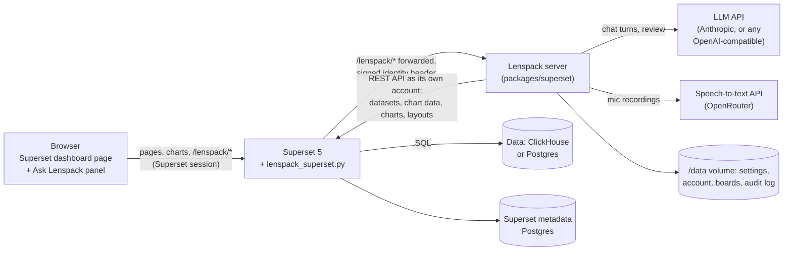

# Architecture: Superset + Lenspack

How the natural-language dashboard assistant is built, deployed and secured. This page describes the setup as it is
in this folder: Lenspack's Superset connector from the `main` branch of
[theflywheel/lenspack](https://github.com/theflywheel/lenspack/tree/main/packages/superset), pinned in
[`lenspack/Dockerfile`](../lenspack/Dockerfile), and stock Apache Superset 5.0. Where the data comes from is in
[ANALYTICS-PIPELINE.md](ANALYTICS-PIPELINE.md).

For the hands-on steps, see [the README](../README.md) (this folder's Compose stack),
[`k8s/README.md`](../k8s/README.md) (Kubernetes) and [Add Lenspack to an existing Superset](ADD-TO-EXISTING-SUPERSET.md).

## Contents

- [Overview](#overview)
- [Design](#design)
- [Structure](#structure)
- [Setup and prerequisites](#setup-and-prerequisites)
- [Deployment](#deployment)
- [Data flow](#data-flow)
- [Security notes](#security-notes)
- [Capacity](#capacity)

## Overview

- Browsers talk to Superset only. Lenspack has no public port.
- Superset runs every query. Lenspack never connects to the data; it asks Superset's chart-data API for every number.
- Changes are ordinary Superset objects: charts, and a dashboard's layout. A dashboard edited through the chat is still
  a normal Superset dashboard, and works without Lenspack.

## Design

### Inside mode

The chat lives on Superset's own dashboard page. Superset's documented template hook `tail_js_custom_extra.html` adds
one small inline script carrying the page's CSP nonce, so Superset's security headers (Talisman) stay on. It loads
`/lenspack/overlay.js`, retrying with backoff while Lenspack is restarting. The overlay adds an **Ask Lenspack** button
and a floating panel that you can move, resize, dock or close. While Lenspack restarts, the button stays, muted and
saying it is reconnecting, an open panel shows a banner and waits, and an answer cut off mid-way gets a Retry button. When the
chat changes the dashboard, the panel asks Superset's single-page app to re-render the dashboard in place. It falls
back to a full reload if that takes too long.

The panel speaks the language picked in its menu (English, French or Hindi, or "Auto": follow Superset's interface
language). The suggested questions, the labels and the replies follow it.

### The proxy through Superset

[`superset/lenspack_superset.py`](../superset/lenspack_superset.py) registers a `/lenspack/<path>` route on Superset
itself. For a signed-in user it forwards the request to the Lenspack container (`LENSPACK_INTERNAL_URL`) and streams
the reply back unbuffered, with `X-Accel-Buffering: no` and no compression. For anyone else it answers 401.

- **Same origin:** no CORS, no second hostname, no proxy or ingress rule for Lenspack.
- **Cross-site requests are refused:** the route checks `Sec-Fetch-Site` and `Origin`.
- **No WebSockets:** chat replies stream over an ordinary `fetch` response.

### Signed identity

On every forwarded request, Superset adds the header `x-lenspack-identity`. Its claims are:
- `u`: the username;
- `a`: whether the user is a Superset admin;
- `d`, `v`, `e`: the dashboard the request is about, and whether Superset would let this user view and edit it;
- `t`: the signing time.

The header is `base64url(JSON) "." HMAC-SHA256`.

- **The key** is derived from Superset's `SECRET_KEY` (`lenspack-identity-v1`). Lenspack fetches it at start from
  `GET /api/v1/lenspack/identity-key`, open only to admins and to Lenspack's own account. There is no second shared secret, and rotating
  `SECRET_KEY` rotates the key (restart Lenspack).
- **Lenspack keeps no users.** A request without a valid signature less than 5 minutes old counts as signed out
  (401). See [`src/identity.ts`](https://github.com/theflywheel/lenspack/blob/main/packages/superset/src/identity.ts).

### Edit policy

Anyone who can view a dashboard can ask about it. Who may change it through the chat is decided by Superset on every
request: by default (`LENSPACK_EDIT_POLICY=superset`) its owners with `can_write` on Dashboard, and admins. Settings
and the audit log are for admins. Someone without edit rights who asks for a change gets a plain answer, nothing
changes, and the refusal is logged. The full table and examples are in
[Who may do what](ADD-TO-EXISTING-SUPERSET-REFERENCE.md#who-may-do-what).

### Lenspack's Superset account

Lenspack reads datasets, runs chart data and saves charts and layouts as its own Superset user, `lenspack`, with the
Admin role, because it edits dashboards it doesn't own. It creates the account on its first start from an admin's
password and keeps the account's password in `/data`, or uses an account you manage (`LENSPACK_SUPERSET_PASSWORD`).
Row-level security on the configured datasets applies to this account, not to the person asking. Details:
[Lenspack's Superset account](ADD-TO-EXISTING-SUPERSET-REFERENCE.md#lenspacks-superset-account).

### Settings

Admins change the chat model and effort, the speech-to-text model, the space-bar hold time and the reply language
on Superset's **Settings → Manage → AI assistant** page (`/ai-assistant/`).

- **How saving works:** the page calls Lenspack through the same signed route as an admin, and Lenspack accepts
  settings writes only from an admin identity.
- **Where they're kept:** `/data/settings.json`. They apply without a restart.
- **Everything else** (datasets, guidance, examples, budget) comes from the Lenspack config file and its environment.

### Packs and boards

- **The pack** is Lenspack's vocabulary. Lenspack builds it at start from Superset's own datasets and saved metrics,
  plus the config file ([`lenspack/lenspack-superset.clickhouse.yaml`](../lenspack/lenspack-superset.clickhouse.yaml)):
  - which datasets to use and what each row means;
  - display names;
  - the model's guidance, including which definition each ambiguous measure uses;
  - suggested questions in English, French and Hindi.

  Every percentage is a Superset saved metric (`sum ÷ sum`), so it is right for any grouping. A design for building
  the pack from Superset alone is in [PACK-FROM-SUPERSET.md](PACK-FROM-SUPERSET.md) (not built).
- **A board** is a Superset dashboard. Lenspack reads its charts and layout, and writes changes back:
  - new or edited charts, as Superset charts;
  - placement, as the dashboard's layout.

  Each change is a version that can be listed and restored ("undo that", "back to the original"). Lenspack edits
  KPI, pie, line, area, bar, table, heatmap and point-map (`deck_scatter`, see [MAPS.md](MAPS.md)) charts. Others stay
  as Superset's: it can move, resize or remove them, but not change their contents.
- **Layout edits** go through core operations (`packages/core/src/ops.ts`):
  - adding to a row fills it before wrapping;
  - moving or resizing within a full row narrows its neighbours proportionally, or refuses with options;
  - a change that has no effect is an error, never a reported success;
  - each result names the rows and widths it changed.

### The chat turn

A turn is one streamed model call with tools (`packages/serve/src/app.ts`).

- **Tools:** read the board, run a query, and add, edit, move, resize or remove a widget.
- **Limits:** up to 12 steps. If the steps run out before a reply, one last call without tools summarises what
  changed and what didn't.
- **Budget:** a daily LLM budget (`budget.usdPerDay`) stops new turns when it's reached.

### Reviewer

After a turn that changed the board, a second model call reviews the result against the request, and the panel shows
its verdict under the reply. The review only informs: it never changes a board by itself. A repair round is opt-in.

### Speech to text

The panel's microphone, and holding the space bar for a set time (default 2 s), record a clip. Lenspack sends it to a
speech-to-text model through OpenRouter (`OPENROUTER_API_KEY`; the model is chosen on the AI assistant page). The
picked language goes along as a hint. A transcript in the wrong script for that language (Persian letters for French,
say) is rejected rather than sent to the chat; with no language picked, Lenspack retries once with the config's fallback
language. Without the key, the microphone is hidden.

### Audit

Lenspack appends one JSON line to `/data/audit.jsonl`, with the Superset user and the dashboard, for every board
change, refused change or request, chat turn and settings change. It rotates monthly, keeps 90 days, and is the durable
record: the usage figures on the settings page reset on restart. Rotation, retention and how to read it:
[The audit log](ADD-TO-EXISTING-SUPERSET-REFERENCE.md#the-audit-log).

## Structure

| Where | What |
|---|---|
| [theflywheel/lenspack](https://github.com/theflywheel/lenspack), branch `main` | Lenspack itself (public) |
| `packages/core` | Board model and layout operations (`ops.ts`), board summaries |
| `packages/mcp` | The chat's tools: board reads and edits, queries, versions |
| `packages/serve` | The chat server: model calls, step cap, reviewer, budget and usage, speech to text, prompt |
| `packages/superset` | The Superset connector: `bin/serve.ts` (the server), `src/catalogue.ts` (pack from datasets), `src/dashboard.ts` and `src/store.ts` (boards as dashboards), `src/identity.ts`, `src/bootstrap.ts`, `src/audit.ts`, `src/settings.ts`, and `web/overlay.js` / `web/chat.js` (the panel) |
| [egovernments/innovations](https://github.com/egovernments/innovations), `nl-dashboard/` | This deployment |
| [`superset/lenspack_superset.py`](../superset/lenspack_superset.py) | Everything Lenspack adds to Superset, in one file: the `/lenspack/` route and signing, the script tag, the AI assistant page, the bootstrap and key endpoints, and the [list-filter fix](ADD-TO-EXISTING-SUPERSET-REFERENCE.md#the-list-filter-fix) |
| [`superset/superset_config.py`](../superset/superset_config.py) | Superset settings from environment variables; imports the file above |
| [`superset/Dockerfile`](../superset/Dockerfile) | Stock `apache/superset:5.0.0` plus database drivers and French labels |
| [`lenspack/`](../lenspack/) | The Lenspack image (pinned commit) and its configs |
| [`setup/setup.mts`](../setup/setup.mts) | One-off: data sources, datasets with saved metrics and descriptions, starter dashboards |
| [`docker-compose.yml`](../docker-compose.yml), [`k8s/`](../k8s/) | The stack on one host, and on Kubernetes |
| [`evals/`](../evals/) | The accuracy suite, definitions register, results and failure analyses |
| [`docs/`](README.md) | These docs, grouped by reader |

## Setup and prerequisites

- **Superset 5.0** that reads your data. ClickHouse needs the `clickhouse-connect` driver.
- **A Superset admin's password**, used once on Lenspack's first start.
- **An LLM key:** `ANTHROPIC_API_KEY`, or `LENSPACK_LLM_PROVIDERS` for other models. For the microphone,
  `OPENROUTER_API_KEY`.
- **HTTPS** in front of Superset for anything beyond one machine. Browsers allow the microphone only on https, and
  Superset's login form sends passwords as typed.
- **Datasets with saved metrics.** `setup/setup.mts` creates them for the HCM analytics views; for other data, define
  them in Superset and list them in the Lenspack config.

## Deployment

| Path | Where it's described | Notes |
|---|---|---|
| **Compose on one host** | [README](../README.md#run-it-with-docker-compose) | Postgres, Superset (this folder's image), Lenspack, a one-off `setup`, and optionally `clickhouse-tunnel`. Superset listens on `BIND_ADDRESS:PORT`. Behind a TLS gateway, set `ENABLE_PROXY_FIX=true`. |
| **Kubernetes** | [k8s/README.md](../k8s/README.md) | The same stack with kustomize: Postgres StatefulSet, Superset and Lenspack Deployments, one Ingress (cert-manager for TLS), and a setup Job. A demo runs this way on a lab VM with minikube, with images from `ghcr.io/theflywheel/lenspack` (`superset-<lenspack sha>` and `superset5-<sha>`). |
| **An existing Superset** | [ADD-TO-EXISTING-SUPERSET.md](ADD-TO-EXISTING-SUPERSET.md) | Stock Superset image, Compose or the official Helm chart. One mounted file plus the import line, and the Lenspack container. No proxy or ingress change. |

Whichever path you use, Lenspack needs a volume at `/data` for settings, its account, board bookkeeping and the audit
log. Without one, it recreates its account on every start (keep the admin password set), and the audit log doesn't
survive.

## Data flow

1. **The browser** loads a dashboard from Superset. Superset queries the data and renders the charts as usual.
2. **The panel** sends a chat turn to `/lenspack/…`. Superset checks the session, signs the identity and forwards it.
3. **Lenspack** calls the model with the pack, the board and the tools. Each query becomes a Superset chart-data call
   made as Lenspack's account, and Superset runs the SQL against the data source.
4. **An edit** becomes Superset API writes: a chart, then the dashboard layout. The panel refreshes the dashboard in
   place, and the reply streams back through Superset.

**ClickHouse in the demo.** Two data paths are in use, both described in
[ANALYTICS-PIPELINE.md](ANALYTICS-PIPELINE.md): eGov's unified-dev ClickHouse, which holds synthetic campaign data, and
a lab ClickHouse holding a masked extract of a real campaign, run through the same eGov pipeline. Superset reaches
unified-dev through a `kubectl port-forward` run as a small service, using a read-only kubeconfig and a read-only
ClickHouse user:
- on one host: the `clickhouse-tunnel` Compose service;
- on Kubernetes: a one-replica Deployment with a TCP liveness probe and a ClusterIP Service.

Superset stores the ClickHouse password encrypted in its metadata database. Lenspack never sees it.

## Security notes

- **Secrets:**

  | Secret | What it is | Lifetime |
  |---|---|---|
  | `SUPERSET_SECRET_KEY` | Sessions, saved database passwords and the identity key | Keep it stable |
  | Superset admin password | Used by Lenspack once, on first start | Can be removed afterwards |
  | LLM and speech-to-text keys | `ANTHROPIC_API_KEY`, `OPENROUTER_API_KEY` | Held only by the Lenspack container, never logged or shown (the settings page names the variable, not the value) |
  | Data-source credentials | Set during setup | Superset stores them encrypted |
  | Read-only kubeconfig (port-forward setups) | Lets the tunnel reach ClickHouse | A Kubernetes Secret: anyone who can read Secrets in that namespace can read it |

- **Identity:** HMAC-SHA256 over the claims with a key derived from `SECRET_KEY`, checked in constant time, rejected
  after 5 minutes. Requests sent straight to Lenspack without a valid header are signed out.
- **Settings and the audit log** are open to Superset admins only. Others get 403.
- **Lenspack's port** should be reachable only from Superset: on one host, don't publish it; on Kubernetes, use a
  ClusterIP Service. A NetworkPolicy is a good extra fence, but not every CNI enforces one (minikube's default doesn't),
  so check yours.
- **The port-forward service** exposes the source database to anything that can reach its Service. Limit it the same
  way, and scope its ClickHouse user to the views the demo needs.
- **`ENABLE_PROXY_FIX`:** turn it on only when Superset sits behind a gateway you control, and let only that gateway
  reach Superset. Superset then trusts the forwarded headers it receives.

## Capacity

Each chat turn holds one of Superset's gunicorn threads while its reply streams, typically 30–60 seconds. Size threads
as **workers × threads ≥ concurrent chats + 10**. Stock Superset (1 worker × 20 threads) serves about 10 simultaneous
chats comfortably; raise `SERVER_THREADS_AMOUNT` or `SERVER_WORKER_AMOUNT` for more. The measurements are in the
[reference guide](ADD-TO-EXISTING-SUPERSET-REFERENCE.md#how-many-chats-at-once).

Lenspack itself is light: one replica uses about 150 MB of memory. Superset with 4 workers × 20 threads uses about 0.8 GB.
